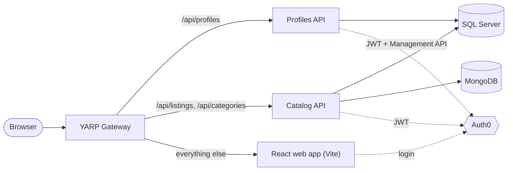

# MarketCustoms

A marketplace platform built as .NET Aspire–orchestrated microservices with a React storefront.

## Overview

MarketCustoms splits a buyer/seller marketplace into bounded-context services behind a YARP gateway. Each service follows Clean Architecture, owns its own data store, and authenticates requests with Auth0. Aspire brings up the whole system with one command: databases, services, gateway and web client.

## Tech stack

- **Backend:** .NET 10, ASP.NET Core, EF Core (SQL Server), MongoDB, FluentValidation, Mapster, Scalar (OpenAPI UI), Bogus (seed data)
- **Platform:** .NET Aspire 13, YARP reverse proxy, OpenTelemetry, service discovery, HTTP resilience
- **Auth:** Auth0 (JWT bearer on the APIs, Auth0 React SDK in the client)
- **Frontend:** React 19, TypeScript, Vite, TanStack Query, Zustand, React Router, Tailwind CSS 4, Feature-Sliced Design
- **Testing:** xUnit v3, Aspire.Hosting.Testing, Vitest

## Architecture



## Services

| Service | Bounded context | Status |
| --- | --- | --- |
| Profiles | User profiles and account types | Active |
| Catalog | Categories, locations and listings | Active |
| Ordering | Orders | Scaffolded |
| Shopping | Carts, favorites and wishlists | Scaffolded |
| Payments | Payments, refunds and seller payouts | Scaffolded |
| Deliveries | Shipping and delivery of orders | Scaffolded |
| Promotions | Promoted listings and discounts | Scaffolded |
| Reviews | Buyer reviews and seller ratings | Scaffolded |
| Conversations | Buyer–seller messaging about listings | Scaffolded |
| Notifications | User notifications | Scaffolded |
| Analytics | Marketplace analytics and KPIs | Scaffolded |

Cross-cutting code (authentication defaults, result types, pagination, seeding) lives in `Services/Shared`.

## Getting started

### Prerequisites

- [.NET 10 SDK](https://dotnet.microsoft.com/download)
- Aspire CLI: `dotnet tool install --global Aspire.Cli`
- EF Core CLI (only for creating migrations): `dotnet tool install --global dotnet-ef`
- [Docker](https://www.docker.com/) (SQL Server, MongoDB and Mongo Express run as containers)
- [Node.js](https://nodejs.org/) for the web client
- An [Auth0](https://auth0.com/) tenant with an API, a single-page application and a machine-to-machine application

### Configure Auth0

Set the AppHost parameters as user secrets:

```bash
dotnet user-secrets --project Aspire/MC.Aspire.AppHost set "Parameters:Auth0-Domain" "<your-auth0-domain>"
dotnet user-secrets --project Aspire/MC.Aspire.AppHost set "Parameters:Auth0-Audience" "<api-identifier>"
dotnet user-secrets --project Aspire/MC.Aspire.AppHost set "Parameters:Auth0-Frontend-ClientId" "<spa-client-id>"
dotnet user-secrets --project Aspire/MC.Aspire.AppHost set "Parameters:Auth0-BackendM2M-ClientId" "<m2m-client-id>"
dotnet user-secrets --project Aspire/MC.Aspire.AppHost set "Parameters:Auth0-BackendM2M-ClientSecret" "<m2m-client-secret>"
```

`Parameters:Auth0-SellerRoleId` is not a secret. Set it to the id of the `seller` role in your tenant. The AppHost passes it to Profiles, which assigns the role when a user becomes a seller. You can set it as a user secret as well:

```bash
dotnet user-secrets --project Aspire/MC.Aspire.AppHost set "Parameters:Auth0-SellerRoleId" "<seller-role-id>"
```

In the Auth0 dashboard:

- **Single-page application:** add `https://localhost:7117/callback` to Allowed Callback URLs, and `https://localhost:7117` to Allowed Logout URLs and Allowed Web Origins. This is the gateway's local address.
- **API permissions:** on the API add `listings:write`, `listings:moderate` and `categories:write`, and turn on "Enable RBAC" and "Add Permissions in the Access Token". Authorise the single-page application for all of them (user-delegated access); each user's roles still decide what their token gets.
- **Roles:** `seller` with `listings:write`, and `admin` with every API permission. Assign `admin` to yourself by hand; Profiles assigns and removes `seller`. Copy the `seller` role id into `Parameters:Auth0-SellerRoleId`.
- **Machine-to-machine application:** authorise it for the Auth0 Management API (client access) with the scopes `update:users`, `create:role_members` and `delete:role_members`. The Profiles service uses it to sync users and assign roles. No application needs user-delegated access to the Management API.
- **Post-login Action:** create one with the code below, deploy it and add it to the Login flow. It copies the profile id that Profiles stores in `app_metadata` into the access token.

  ```js
  exports.onExecutePostLogin = async (event, api) => {
    const profileId = event.user.app_metadata?.profile_id;
    if (profileId) {
      api.accessToken.setCustomClaim("https://marketcustoms/profile_id", profileId);
    }
  };
  ```

To check the setup: a new user's second access token has `https://marketcustoms/profile_id`; after choosing "Private seller" in Settings the next token has `permissions: ["listings:write"]`; `POST /api/categories` returns 403 for that user and 200 for an admin.

### Run

```bash
cd Clients/mc.market.reactwebapp && npm install && cd ../..
aspire run
```

The Aspire dashboard opens with every resource, its logs and its traces. Open the **marketCustomsGateway** endpoint to use the storefront. SQL Server is exposed on host port `14333`. Database containers and their volumes persist between runs, and so does your data (see below).

> **Seeding:** `Seeding:Mode` in `Aspire/MC.Aspire.AppHost/appsettings.json` defaults to `IfEmpty`, which seeds only empty databases. Set it to `Reset` to drop and reseed the databases on every start, or `None` to skip seeding.

## Testing

```bash
dotnet test
```

This runs unit and integration tests. Integration tests start the service under test in an isolated Aspire composition. Catalog and Profiles tests use throwaway database containers and a local test identity, so they need Docker but not Auth0.

Web client tests:

```bash
cd Clients/mc.market.reactwebapp
npm run test
```

## Database migrations

EF Core migrations for the SQL Server databases (Profiles and Catalog) are wrapped by root npm scripts:

```bash
npm run ef:add -- Catalog AddCategoryTree
npm run ef:list -- Catalog
npm run ef:remove -- Catalog
```

## Project structure

See [STRUCTURE.md](STRUCTURE.md) for the repository layout, the service layering rules and what each project contains.

## Roadmap

See [ROADMAP.md](docs/development_plan/ROADMAP.md) for the phased development plan, from the MVP to later features.

## License

Released under the [MIT License](LICENSE.md).
