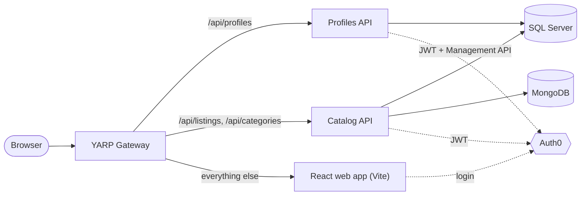

# MarketCustoms

A marketplace platform built as .NET Aspire–orchestrated microservices with a React storefront.

## Overview

MarketCustoms splits a buyer/seller marketplace into bounded-context services behind a YARP gateway. Each service follows Clean Architecture, owns its own data store, and authenticates requests with Auth0. Aspire brings up the whole system with one command: databases, services, gateway and web client.

## Tech stack

- **Backend:** .NET 10, ASP.NET Core, EF Core (SQL Server), MongoDB, FluentValidation, Mapster, Scalar (OpenAPI UI), Bogus (seed data)
- **Platform:** .NET Aspire 13, YARP reverse proxy, OpenTelemetry, service discovery, HTTP resilience
- **Auth:** Auth0 (JWT bearer on the APIs, Auth0 React SDK in the client)
- **Frontend:** React 19, TypeScript, Vite, TanStack Query, Zustand, React Router, Tailwind CSS 4, Feature-Sliced Design
- **Testing:** xUnit v3, Aspire.Hosting.Testing, Vitest

## Architecture



## Services

| Service | Bounded context | Status |
| --- | --- | --- |
| Profiles | User profiles and account types | Active |
| Catalog | Categories, locations and listings | Active |
| Ordering | Orders | Scaffolded |
| Shopping | Buyer shopping flow | Scaffolded |
| Financial | Payments and payouts | Scaffolded |
| Delivering | Shipping and delivery | Scaffolded |
| Promotion | Promoted listings and discounts | Scaffolded |
| Interaction | Buyer–seller interactions | Scaffolded |
| Notifications | User notifications | Scaffolded |
| Statistics | Marketplace analytics | Scaffolded |

Cross-cutting code (authentication defaults, result types, pagination, seeding) lives in `Services/Shared`.

## Getting started

### Prerequisites

- [.NET 10 SDK](https://dotnet.microsoft.com/download)
- Aspire CLI: `dotnet tool install --global Aspire.Cli`
- EF Core CLI (only for creating migrations): `dotnet tool install --global dotnet-ef`
- [Docker](https://www.docker.com/) (SQL Server, MongoDB and Mongo Express run as containers)
- [Node.js](https://nodejs.org/) for the web client
- An [Auth0](https://auth0.com/) tenant with an API, a single-page application and a machine-to-machine application

### Configure Auth0

Set the AppHost parameters as user secrets:

```bash
dotnet user-secrets --project Aspire/MC.Aspire.AppHost set "Parameters:Auth0-Domain" "<your-auth0-domain>"
dotnet user-secrets --project Aspire/MC.Aspire.AppHost set "Parameters:Auth0-Audience" "<api-identifier>"
dotnet user-secrets --project Aspire/MC.Aspire.AppHost set "Parameters:Auth0-Frontend-ClientId" "<spa-client-id>"
dotnet user-secrets --project Aspire/MC.Aspire.AppHost set "Parameters:Auth0-BackendM2M-ClientId" "<m2m-client-id>"
dotnet user-secrets --project Aspire/MC.Aspire.AppHost set "Parameters:Auth0-BackendM2M-ClientSecret" "<m2m-client-secret>"
```

In the Auth0 dashboard:

- **Single-page application:** add `https://localhost:7117/callback` to Allowed Callback URLs, and `https://localhost:7117` to Allowed Logout URLs and Allowed Web Origins. This is the gateway's local address.
- **Machine-to-machine application:** authorise it for the Auth0 Management API. The Profiles service uses it to sync users.

### Run

```bash
cd Clients/mc.market.reactwebapp && npm install && cd ../..
aspire run
```

The Aspire dashboard opens with every resource, its logs and its traces. Open the **marketCustomsGateway** endpoint to use the storefront. SQL Server is exposed on host port `14333`. Database containers and their volumes persist between runs, but seeding may still reset the data (see below).

> **Seeding:** `Seeding:Mode` in `Aspire/MC.Aspire.AppHost/appsettings.json` defaults to `Reset`, which drops and reseeds the databases on every start. Set it to `IfEmpty` or `None` to keep your data.

## Testing

```bash
dotnet test
```

This runs unit and integration tests. Integration tests start the service under test in an isolated Aspire composition. Catalog and Profiles tests use throwaway database containers and a local test identity, so they need Docker but not Auth0.

Web client tests:

```bash
cd Clients/mc.market.reactwebapp
npm run test
```

## Database migrations

EF Core migrations for the SQL Server databases (Profiles and Catalog) are wrapped by root npm scripts:

```bash
npm run ef:add -- Catalog AddCategoryTree
npm run ef:list -- Catalog
npm run ef:remove -- Catalog
```

## Project structure

See [STRUCTURE.md](STRUCTURE.md) for the repository layout, the service layering rules and what each project contains.

## License

Released under the [MIT License](LICENSE.md).
