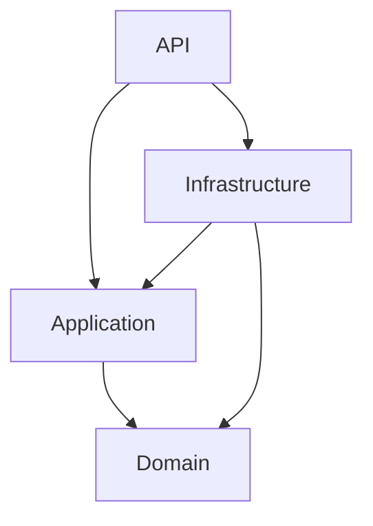

# Project structure

MarketCustoms is a single repository containing every backend service, the API gateway, the web client and the tests, orchestrated locally by .NET Aspire.

## Top level

```text
Aspire/
  MC.Aspire.AppHost/          Aspire orchestrator: containers, services, client, test composition
  MC.Aspire.ServiceDefaults/  Shared telemetry, health checks, service discovery, resilience
Clients/
  mc.market.reactwebapp/      React storefront (Vite + TypeScript)
Gateway/
  MC.Gateway/                 YARP reverse proxy, the single entry point for the client
Services/
  <Service>/                  One folder per bounded context, four projects each
  Shared/                     Cross-cutting building blocks used by every service
Tests/
  <Service>/                  Unit and integration test projects per service
scripts/
  ef.js                       EF Core migration helper behind the root npm scripts
.github/workflows/            GitHub Actions pipelines

MarketCustoms.slnx            Solution file (XML format)
Directory.Packages.props      Central NuGet package versions
aspire.config.json            Points the Aspire CLI at the AppHost
package.json                  Root npm scripts (EF migrations)
dotnet-tools.json             Local .NET tool manifest
```

## Service layering

Every service under `Services/<Service>/` follows the same Clean Architecture split into four projects, named `MC.<Service>.<Layer>`:

| Project | Responsibility |
| --- | --- |
| `MC.<Service>.API` | ASP.NET Core host: controllers, request/response contracts, validation wiring, `Program.cs` |
| `MC.<Service>.Application` | Use cases and application services, DTOs, repository and service interfaces |
| `MC.<Service>.Domain` | Entities, value objects and domain rules, with no infrastructure dependencies |
| `MC.<Service>.Infrastructure` | EF Core / MongoDB persistence, repositories, external integrations, seeding |



Domain depends on nothing. Application depends only on Domain. Infrastructure implements the interfaces declared in Application. API composes everything at startup. Each layer may also reference its matching `MC.Shared.<Layer>` project.

## Services

| Service | Bounded context |
| --- | --- |
| Profiles | User profiles and account types, synchronised with Auth0 users |
| Catalog | Categories, locations and listings |
| Ordering | Orders placed by buyers |
| Shopping | Buyer-side shopping flow before an order is placed |
| Financial | Payments and payouts |
| Delivering | Shipping and delivery of orders |
| Promotion | Promoted listings and discounts |
| Interaction | Interactions between buyers and sellers |
| Notifications | User notifications |
| Statistics | Marketplace analytics |

Only Profiles and Catalog run in the local Aspire environment. Ordering and Notifications are started only by the isolated integration-test composition. The rest are scaffolded with the four-project layout.

Persistence per running service:

- **Profiles:** SQL Server (EF Core).
- **Catalog:** SQL Server for categories and locations, MongoDB for listings.

## Shared

`Services/Shared/` holds code reused by all services. It has no Domain project because it carries no business vocabulary.

| Project | Provides |
| --- | --- |
| `MC.Shared.API` | `AddAuthenticationDefaults()` (Auth0 JWT, or a local test identity when `Authentication:UseLocalTestIdentity` is set), a base `CustomController`, and `UseClientCancellationLogging()` middleware that logs client-aborted requests |
| `MC.Shared.Application` | `Result` / `Error` types, pagination models and parameters, `IUnitOfWork`, `ICurrentUserService` |
| `MC.Shared.Infrastructure` | Deterministic database seeding (`IDatabaseSeeder`, seeding options and modes) and `Auth0CurrentUserService` |

## Gateway

`Gateway/MC.Gateway` is a YARP reverse proxy and the only externally exposed endpoint. Routes are defined in `appsettings.json` and resolved to service addresses through Aspire service discovery:

| Path | Destination |
| --- | --- |
| `/api/profiles/**` | Profiles service |
| `/api/listings/**`, `/api/categories/**` | Catalog service |
| everything else | React web app |

## Aspire

- **AppHost** builds the local environment: SQL Server and MongoDB containers (plus Mongo Express), the Profiles and Catalog services, the Vite dev server and the gateway. It passes Auth0 and seeding settings to each resource. When `MarketCustoms:TestService` is set, it switches to an isolated composition that starts a single service for integration tests.
- **ServiceDefaults** is referenced by every host and adds OpenTelemetry, `/health` and `/alive` endpoints, service discovery and HTTP resilience.

## Clients

`Clients/mc.market.reactwebapp` is the React storefront, organised with Feature-Sliced Design. See its [README](Clients/mc.market.reactwebapp/README.md) for the layer rules and commands.

## Tests

```text
Tests/
  <Service>/
    MC.<Service>.UnitTests/         Fast tests for Domain and Application logic
    MC.<Service>.IntegrationTests/  Run the service through Aspire.Hosting.Testing with real containers
  Shared/
    MC.Shared.UnitTests/
```

Test projects exist for Catalog, Profiles, Ordering, Notifications and Shared. They use xUnit v3.

## Conventions

- All projects are prefixed `MC.` and namespaced to match their folder.
- NuGet versions are managed centrally in `Directory.Packages.props`. Project files reference packages without a version.
