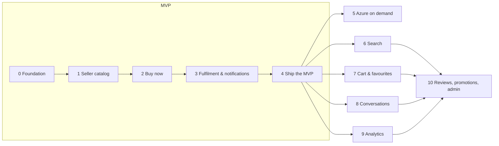

# MarketCustoms roadmap

MarketCustoms is a portfolio and learning project. The goal is to learn a broad set of technologies by using each one for a real marketplace feature that needs it, and to keep the code clean enough that ideas and code can be reused in real projects. There is no commercial launch: payments run in Stripe test mode, emails are caught locally, the system is deployed to a local Kubernetes cluster, and Azure is used on demand (deploy, demo, delete) so it costs nothing.

The roadmap starts with an MVP (Phases 0–4) that covers the core story: **a seller lists an item, a buyer pays, the seller ships and gets paid, and the whole system is deployed.** Later phases add an on-demand Azure deployment, search, a cart, chat, analytics and more.

## How to use this roadmap

- This document stays high-level and covers the whole project. Each phase is described in its own file under [`phases/`](phases/), linked from the [phase overview](#phase-overview): goal, user story, scope, open decisions and what "done" means. A phase file can grow as the phase is discussed.
- When a phase starts, it gets its own design and plan in `docs/superpowers/specs/` and `docs/superpowers/plans/`, broken into tasks for each endpoint and each slice.
- Update the **Status** column in the phase overview when a phase starts and when it finishes.
- Every new technology or library choice gets a short ADR (Architecture Decision Record) in [`docs/adr/`](../adr/README.md): the context, the options considered, the decision and its consequences. Each phase file lists the decisions it has to make under **Open decisions**.
- Ideas that don't belong to a phase yet go into the [parking lot](#parking-lot), not into a phase's scope.

## Principles

- **Feature-led slices.** Each phase delivers a part of the marketplace flow that you can demo. It brings in only the technologies that feature needs, and a phase can add none.
- **A demoable state after every phase.** `aspire run` starts, the new flow works from the browser, and CI is green.
- **Definition of done for a feature:**
  - API endpoint with request validation and `Result`-based error handling;
  - unit tests for domain and business logic, plus integration tests through `Aspire.Hosting.Testing`;
  - gateway route in YARP;
  - client slice in the React app (Feature-Sliced Design);
  - CI green;
  - docs updated (`README.md`, `STRUCTURE.md`, an [ADR](../adr/README.md) if a technology or library was chosen).
- **Run only what you are working on.** SQL Server, MongoDB, RabbitMQ, Redis, Elasticsearch, Kafka, 11 APIs, the gateway and Vite will not all fit in 16 GB of RAM. Add services to the AppHost when their phase starts, and consider launch profiles or flags to switch groups off.
- **Each technology has its own job.** See the [technology map](#technology-map). If two tools would do the same job, the ADR says why only one of them does it. The exception is deliberate local/cloud pairs (RabbitMQ and Service Bus, MongoDB and DocumentDB), where the point is that only configuration changes.
- **Local runs never need Azure.** `aspire run` uses emulators and containers (Azurite, RabbitMQ, MongoDB, SQL Server). Azure AI services have no emulator, so they sit behind an interface with a fake that is used when no key is configured.

## Where we are today

- Only **Profiles** and **Catalog** run in the AppHost. The other 9 services (Ordering, Shopping, Payments, Deliveries, Promotions, Reviews, Conversations, Notifications, Analytics) are scaffolds with the four-project layout. Ordering and Notifications have test projects, but no real tests yet.
- **CI and branching:** a single workflow, `.github/workflows/ci.yml`, tests the changed backend areas (Catalog, Profiles, Shared) and the client on every PR into `main`. Its `ci-ok` job is the only required check. The repository uses GitHub flow: `main` is the only long-lived branch ([ADR 0001](../adr/0001-github-flow.md), [ADR 0002](../adr/0002-single-ci-workflow.md)).
- **Profiles:** account types are `Basic`, `Individual` and `Business`. There is no separate buyer or seller role.
- **Catalog:** listings live in MongoDB, and categories and locations in SQL Server. `Listing` has `StockQuantity` (a listing can have several units) and no status. Listings can be read, searched and created, but not updated or deleted. `POST /categories` is open to any authenticated user.
- **Web client:** `home`, `browse`, `listing-details`, `profile`, `settings`, `orders`, `login`, `callback` and `verify-email` pages exist. Several show placeholder data.
- `Seeding:Mode` defaults to `IfEmpty`, which seeds only empty databases.

## Technology map

| Technology | Job in MarketCustoms | Phase(s) |
| --- | --- | --- |
| GitHub Actions (CI/CD) | Build and test every service and the client on each PR; build images and deploy to the cluster; on-demand Azure deploy and teardown | 0, 4, 5 |
| Auth0 | Login (already in use); roles and permissions (admin, selling rights); service-to-service tokens | 1, 10 |
| Azure Blob Storage (Azurite locally) | Listing images and thumbnails | 1, 5 |
| Redis | Cache (category tree, listing pages), stock reservation locks, cart storage, SignalR backplane | 1, 2, 7, 8 |
| RabbitMQ | Workflow messaging between services: commands and integration events, outbox, checkout saga | 2, 3, 6, 10 |
| Stripe | Checkout and webhooks (Phase 2); Connect onboarding and seller payouts (Phase 3); paid promotions (Phase 10). Test mode only. | 2, 3, 10 |
| SignalR | Live notifications and order status updates; buyer–seller chat | 3, 8 |
| Kubernetes + Helm | Running the whole system on a local `kind` cluster | 4, 8 |
| Azure Container Apps, `azd`, Bicep | Deploying the Aspire AppHost to Azure for a short demo, then deleting it | 5 |
| Azure SQL Database, Azure DocumentDB | Cloud counterparts of SQL Server and MongoDB (free offers) | 5 |
| Azure Service Bus | Cloud transport for the same messages RabbitMQ carries locally | 5 |
| Azure Key Vault, managed identity, container registry | Secrets without connection strings in config; images for Container Apps | 5 |
| Azure Functions | Blob-triggered image thumbnails | 5 |
| Elasticsearch | Full-text listing search, facets, autocomplete | 6 |
| Azure AI Vision | Image tags and alt text for listings, feeding search facets | 6 |
| Azure AI Search (optional) | Comparison with Elasticsearch on the same index | 6 |
| Kafka | High-volume event stream (views, searches, orders) feeding Analytics | 9 |
| Azure AI Content Safety | Flagging images and review text for admin moderation | 10 |
| Aspire, YARP, OpenTelemetry (existing) | Local orchestration, gateway, traces and metrics; extended as each phase adds resources | all |

**How RabbitMQ, Kafka and Redis divide the work.** RabbitMQ carries business workflow: a small number of important messages that must each be handled exactly once (for example "order paid" → "decrement stock"). Kafka carries a stream of facts that can be replayed and read by many consumers (for example "listing viewed" → analytics). Redis holds short-lived, fast state (cache, locks, carts, backplane), never the system of record.

**Azure on a student account.** The goal is zero spend. Azure resources exist only for a demo and are deleted afterwards, except free-forever ones (the DocumentDB free cluster, AI services on their free F0 tier). The $100 student credit and the 12-month free services expire, so Phase 5 should follow the MVP closely. Do not use:

- **AKS:** the free B-series VMs are too small for its nodes, and real nodes would use up the credit in weeks. Kubernetes stays on `kind`.
- **Managed Redis:** no free tier. Redis runs as a container.
- **Retired or retiring services** that still show up in the student offer list: QnA Maker, LUIS (Language Understanding), Ink Recognizer, Media Services, Anomaly Detector, Personalizer and Content Moderator (replaced by AI Content Safety).

## Phase overview

| # | Phase | Demo at the end | New technology | Status |
| --- | --- | --- | --- | --- |
| 0 | [Foundation](phases/phase-00-foundation.md) | Single CI workflow required on `main`; GitHub flow; ADR folder | GitHub Actions CI | Done |
| 1 | [Seller catalog](phases/phase-01-seller-catalog.md) | Owners create, edit and remove listings with images; listing status; admin-only categories | Auth0 roles/permissions, Azure Blob (Azurite), first Redis cache | In progress |
| 2 | [Buy now](phases/phase-02-buy-now.md) | Single-listing purchase in Stripe test mode; stock reserved, then decremented; seller sees the paid order | RabbitMQ, outbox, checkout saga, Stripe Checkout + webhooks | Not started |
| 3 | [Fulfilment & notifications](phases/phase-03-fulfilment-and-notifications.md) | Tracking number, buyer confirms receipt, then seller payout; email and live notifications | Stripe Connect payouts, SignalR | Not started |
| 4 | [Ship the MVP](phases/phase-04-ship-the-mvp.md) | Full system on a local `kind` cluster, auto-deployed from `main` | Kubernetes, Helm, GHCR images, CD | Not started |
| 5 | [Azure on demand](phases/phase-05-azure-on-demand.md) | `azd up` deploys the MVP to Azure, a smoke test passes, `azd down` deletes it; image thumbnails | Container Apps, `azd`/Bicep, Azure SQL, DocumentDB, Service Bus, Key Vault, managed identity, Functions | Not started |
| 6 | [Search](phases/phase-06-search.md) | Full-text search, facets, autocomplete; AI image tags | Elasticsearch, synced from listing events; Azure AI Vision | Not started |
| 7 | [Cart & favourites](phases/phase-07-cart-and-favourites.md) | Multi-seller cart split into one order per seller; wishlists | Redis as a data store | Not started |
| 8 | [Conversations](phases/phase-08-conversations.md) | Buyer–seller chat about a listing | SignalR with a Redis backplane on Kubernetes | Not started |
| 9 | [Analytics](phases/phase-09-analytics.md) | Seller stats (views, conversions, revenue) | Kafka as an event stream | Not started |
| 10 | [Reviews, promotions, admin](phases/phase-10-reviews-promotions-and-admin.md) | Ratings, paid promoted listings, admin panel with a moderation queue | Azure AI Content Safety (otherwise reuses Stripe and RabbitMQ) | Not started |

Phases 5–9 depend on the MVP but not on each other, so their order can change if one technology becomes more interesting. Phase 5 goes first because the student credit expires. Once it exists, later phases can add their new resources to the Azure deployment, but they don't have to.

## Parking lot

Ideas that may become phases later:

- AKS: the Phase 4 Helm charts on a managed cluster. Only for a short experiment: its nodes don't fit the free VM sizes and would use up the student credit quickly.
- Carrier API integration and shipping labels in Deliveries.
- A second client (mobile with React Native, or a Blazor admin app).
- Azure Communication Services for real email delivery in the Azure deployment (see the Phase 3 open decision).
- Feature flags, A/B tests on the storefront.
- Load testing (k6) against the Kubernetes deployment.

## Not in this project

These belong to a real launch and are deliberately left out: legal pages and GDPR documentation, VAT and invoices, real KYC (beyond Stripe test-mode onboarding), consumer return rules and a soft launch with real sellers.

## Links

- [Roadmap design](../superpowers/specs/2026-11-16-roadmap-design.md)
- [README](../../README.md)
- [Project structure](../../STRUCTURE.md)
