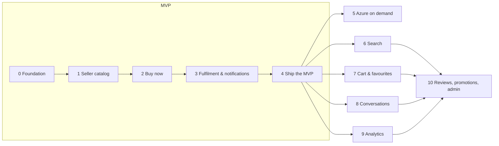

# MarketCustoms roadmap

MarketCustoms is a portfolio and learning project. The goal is to learn a broad set of technologies by using each one for a real marketplace feature that needs it, and to keep the code clean enough that ideas and code can be reused in real projects. There is no commercial launch: payments run in Stripe test mode, emails are caught locally, the system is deployed to a local Kubernetes cluster, and Azure is used on demand (deploy, demo, delete) so it costs nothing.

The roadmap starts with an MVP (Phases 0–4) that covers the core story: **a seller lists an item, a buyer pays, the seller ships and gets paid, and the whole system is deployed.** Later phases add an on-demand Azure deployment, search, a cart, chat, analytics and more.

## How to use this roadmap

- This document stays high-level. When a phase starts, it gets its own design and plan in `docs/superpowers/specs/` and `docs/superpowers/plans/`, broken into tasks for each endpoint and each slice.
- Update the **Status** column in the phase overview when a phase starts and when it finishes.
- Every new technology or library choice gets a short ADR (Architecture Decision Record) in [`docs/adr/`](../adr/README.md): the context, the options considered, the decision and its consequences. Each phase lists the decisions it has to make under **Open decisions**.
- Ideas that don't belong to a phase yet go into the [parking lot](#parking-lot), not into a phase's scope.

## Principles

- **Feature-led slices.** Each phase delivers a part of the marketplace flow that you can demo. It brings in only the technologies that feature needs, and a phase can add none.
- **A demoable state after every phase.** `aspire run` starts, the new flow works from the browser, and CI is green.
- **Definition of done for a feature:**
  - API endpoint with request validation and `Result`-based error handling;
  - unit tests for domain and business logic, plus integration tests through `Aspire.Hosting.Testing`;
  - gateway route in YARP;
  - client slice in the React app (Feature-Sliced Design);
  - CI green;
  - docs updated (`README.md`, `STRUCTURE.md`, an [ADR](../adr/README.md) if a technology or library was chosen).
- **Run only what you are working on.** SQL Server, MongoDB, RabbitMQ, Redis, Elasticsearch, Kafka, 11 APIs, the gateway and Vite will not all fit in 16 GB of RAM. Add services to the AppHost when their phase starts, and consider launch profiles or flags to switch groups off.
- **Each technology has its own job.** See the [technology map](#technology-map). If two tools would do the same job, the ADR says why only one of them does it. The exception is deliberate local/cloud pairs (RabbitMQ and Service Bus, MongoDB and DocumentDB), where the point is that only configuration changes.
- **Local runs never need Azure.** `aspire run` uses emulators and containers (Azurite, RabbitMQ, MongoDB, SQL Server). Azure AI services have no emulator, so they sit behind an interface with a fake that is used when no key is configured.

## Where we are today

- Only **Profiles** and **Catalog** run in the AppHost. The other 9 services (Ordering, Shopping, Payments, Deliveries, Promotions, Reviews, Conversations, Notifications, Analytics) are scaffolds with the four-project layout. Ordering and Notifications have test projects, but no real tests yet.
- **CI and branching:** a single workflow, `.github/workflows/ci.yml`, tests the changed backend areas (Catalog, Profiles, Shared) and the client on every PR into `main`. Its `ci-ok` job is the only required check. The repository uses GitHub flow: `main` is the only long-lived branch ([ADR 0001](../adr/0001-github-flow.md), [ADR 0002](../adr/0002-single-ci-workflow.md)).
- **Profiles:** account types are `Basic`, `Individual` and `Business`. There is no separate buyer or seller role.
- **Catalog:** listings live in MongoDB, and categories and locations in SQL Server. `Listing` has `StockQuantity` (a listing can have several units) and no status. Listings can be read, searched and created, but not updated or deleted. `POST /categories` is open to any authenticated user.
- **Web client:** `home`, `browse`, `listing-details`, `profile`, `settings`, `orders`, `login`, `callback` and `verify-email` pages exist. Several show placeholder data.
- `Seeding:Mode` defaults to `IfEmpty`, which seeds only empty databases.

## Technology map

| Technology | Job in MarketCustoms | Phase(s) |
| --- | --- | --- |
| GitHub Actions (CI/CD) | Build and test every service and the client on each PR; build images and deploy to the cluster; on-demand Azure deploy and teardown | 0, 4, 5 |
| Auth0 | Login (already in use); roles and permissions (admin, selling rights); service-to-service tokens | 1, 10 |
| Azure Blob Storage (Azurite locally) | Listing images and thumbnails | 1, 5 |
| Redis | Cache (category tree, listing pages), stock reservation locks, cart storage, SignalR backplane | 1, 2, 7, 8 |
| RabbitMQ | Workflow messaging between services: commands and integration events, outbox, checkout saga | 2, 3, 6, 10 |
| Stripe | Checkout and webhooks (Phase 2); Connect onboarding and seller payouts (Phase 3); paid promotions (Phase 10). Test mode only. | 2, 3, 10 |
| SignalR | Live notifications and order status updates; buyer–seller chat | 3, 8 |
| Kubernetes + Helm | Running the whole system on a local `kind` cluster | 4, 8 |
| Azure Container Apps, `azd`, Bicep | Deploying the Aspire AppHost to Azure for a short demo, then deleting it | 5 |
| Azure SQL Database, Azure DocumentDB | Cloud counterparts of SQL Server and MongoDB (free offers) | 5 |
| Azure Service Bus | Cloud transport for the same messages RabbitMQ carries locally | 5 |
| Azure Key Vault, managed identity, container registry | Secrets without connection strings in config; images for Container Apps | 5 |
| Azure Functions | Blob-triggered image thumbnails | 5 |
| Elasticsearch | Full-text listing search, facets, autocomplete | 6 |
| Azure AI Vision | Image tags and alt text for listings, feeding search facets | 6 |
| Azure AI Search (optional) | Comparison with Elasticsearch on the same index | 6 |
| Kafka | High-volume event stream (views, searches, orders) feeding Analytics | 9 |
| Azure AI Content Safety | Flagging images and review text for admin moderation | 10 |
| Aspire, YARP, OpenTelemetry (existing) | Local orchestration, gateway, traces and metrics; extended as each phase adds resources | all |

**How RabbitMQ, Kafka and Redis divide the work.** RabbitMQ carries business workflow: a small number of important messages that must each be handled exactly once (for example "order paid" → "decrement stock"). Kafka carries a stream of facts that can be replayed and read by many consumers (for example "listing viewed" → analytics). Redis holds short-lived, fast state (cache, locks, carts, backplane), never the system of record.

**Azure on a student account.** The goal is zero spend. Azure resources exist only for a demo and are deleted afterwards, except free-forever ones (the DocumentDB free cluster, AI services on their free F0 tier). The $100 student credit and the 12-month free services expire, so Phase 5 should follow the MVP closely. Do not use:

- **AKS:** the free B-series VMs are too small for its nodes, and real nodes would use up the credit in weeks. Kubernetes stays on `kind`.
- **Managed Redis:** no free tier. Redis runs as a container.
- **Retired or retiring services** that still show up in the student offer list: QnA Maker, LUIS (Language Understanding), Ink Recognizer, Media Services, Anomaly Detector, Personalizer and Content Moderator (replaced by AI Content Safety).

## Phase overview

| # | Phase | Demo at the end | New technology | Status |
| --- | --- | --- | --- | --- |
| 0 | Foundation | Single CI workflow required on `main`; GitHub flow; ADR folder | GitHub Actions CI | Done |
| 1 | Seller catalog | Owners create, edit and remove listings with images; listing status; admin-only categories | Auth0 roles/permissions, Azure Blob (Azurite), first Redis cache | Not started |
| 2 | Buy now | Single-listing purchase in Stripe test mode; stock reserved, then decremented; seller sees the paid order | RabbitMQ, outbox, checkout saga, Stripe Checkout + webhooks | Not started |
| 3 | Fulfilment & notifications | Tracking number, buyer confirms receipt, then seller payout; email and live notifications | Stripe Connect payouts, SignalR | Not started |
| 4 | Ship the MVP | Full system on a local `kind` cluster, auto-deployed from `main` | Kubernetes, Helm, GHCR images, CD | Not started |
| 5 | Azure on demand | `azd up` deploys the MVP to Azure, a smoke test passes, `azd down` deletes it; image thumbnails | Container Apps, `azd`/Bicep, Azure SQL, DocumentDB, Service Bus, Key Vault, managed identity, Functions | Not started |
| 6 | Search | Full-text search, facets, autocomplete; AI image tags | Elasticsearch, synced from listing events; Azure AI Vision | Not started |
| 7 | Cart & favourites | Multi-seller cart split into one order per seller; wishlists | Redis as a data store | Not started |
| 8 | Conversations | Buyer–seller chat about a listing | SignalR with a Redis backplane on Kubernetes | Not started |
| 9 | Analytics | Seller stats (views, conversions, revenue) | Kafka as an event stream | Not started |
| 10 | Reviews, promotions, admin | Ratings, paid promoted listings, admin panel with a moderation queue | Azure AI Content Safety (otherwise reuses Stripe and RabbitMQ) | Not started |

Phases 5–9 depend on the MVP but not on each other, so their order can change if one technology becomes more interesting. Phase 5 goes first because the student credit expires. Once it exists, later phases can add their new resources to the Azure deployment, but they don't have to.

## Phase 0: Foundation

**Goal:** a safety net and shared rules before any new feature work.

**User story:** as the developer, every push to `main` and every PR tells me whether the backend and the client still build and pass their tests.

**Services touched:** none (repository and docs).

**Spec and plan:** [design](../superpowers/specs/2026-11-16-phase-0-foundation-design.md), [plan](../superpowers/plans/2026-11-17-phase-0-foundation.md).

**Scope:**

- Replace the broken `backend-catalog-ci.yml` with a single `ci.yml`: a `changes` job, a backend matrix over the changed areas (Catalog, Profiles, Shared; Ordering and Notifications join in Phases 2 and 3), a `client` job (`npm run validate`, `npm run test`, `npm run build`) and an aggregate `ci-ok` job. Ubuntu runners have Docker, so the Aspire integration tests run there.
- GitHub flow: delete the `staging` and `production` branches, and add a ruleset on `main` that requires a PR and the `ci-ok` check and blocks force pushes and deletion.
- Create `docs/adr/` with a template, ADR 0001 (GitHub flow) and ADR 0002 (single CI workflow).
- A short project `CLAUDE.md` that points to the definition of done above, the ADR rule and the branching model.
- Switch `Seeding:Mode` to `IfEmpty`.

**Out of scope:** deployment (Phase 4), new features, `dotnet format` and `format:check` in CI, coverage, Dependabot.

**New technology:** GitHub Actions (beyond the one broken workflow).

**Open decisions:** resolved. One workflow with change detection ([ADR 0002](../adr/0002-single-ci-workflow.md)).

**Done when:**

- [x] A PR that touches only Catalog runs only the Catalog backend job. A PR that touches only the client runs only the client checks. A PR that touches `Services/Shared` runs every backend area.
- [x] A deliberately failing test makes `ci-ok` fail, and the ruleset blocks the merge.
- [x] `docs/adr/` exists with ADRs 0001 and 0002.
- [x] `staging` and `production` no longer exist on the remote.

## Phase 1: Seller catalog

**Goal:** sellers fully manage their own listings.

**User story:** as a seller, I create a listing with photos, publish it, edit it, and take it down. Nobody else can change my listings.

**Services touched:** Catalog, Profiles, Gateway, web client.

**Scope:**

- Listing status lifecycle: `Draft`, `Active`, `SoldOut`, `Removed`. `SoldOut` is set automatically when `StockQuantity` reaches 0. Only `Active` listings appear in search.
- Update, publish, unpublish and delete endpoints, with an ownership check (only the owner, or an admin).
- Selling rights: decide how `AccountType` (`Basic` / `Individual` / `Business`) maps to who can create listings, and enforce it.
- Auth0 roles and permissions: an `admin` role, permissions in the access token, a policy-based authorization helper in `MC.Shared.API`. `POST /categories` becomes admin-only.
- Image upload to Azure Blob Storage (Azurite locally via Aspire): upload, size and type validation, delete when a listing is removed.
- First Redis use: cache the category tree (cache-aside or output caching) with invalidation when categories change.
- React: a seller dashboard ("My listings") with create and edit forms, image upload and status actions.

**Out of scope:** search beyond the existing filters (Phase 6), orders.

**New technology:** Auth0 RBAC, Azure Blob Storage / Azurite, Redis (cache).

**Open decisions:**

- Is there a `Reserved` status for a multi-unit listing, or is reservation tracked per unit (Phase 2)? Recommendation: track it per unit, with no listing-level `Reserved`.
- Permissions in Auth0 roles vs an app-side mapping from `AccountType`.
- Upload directly to the API vs a SAS URL that lets the browser upload straight to Blob.

**Done when:**

- [ ] A seller creates, publishes, edits and removes a listing with images from the browser.
- [ ] Editing someone else's listing returns 403 (integration test).
- [ ] A non-admin gets 403 on `POST /categories`.
- [ ] The category tree is served from Redis on the second request (visible in traces).

## Phase 2: Buy now

**Goal:** a buyer pays for a single listing, and the system stays consistent across services. This is the hardest phase.

**User story:** as a buyer, I click "Buy now", pay with a Stripe test card, and see my order as paid. As a seller, I see the paid order. Two buyers can never pay for the last unit.

**Services touched:** Ordering, Payments, Catalog, Gateway, web client (`orders` page).

**Scope:**

- Ordering service in the AppHost with its own database. Order state machine: `Created`, `PendingPayment`, `Paid`, `Shipped`, `Completed`, `Cancelled`, `Refunded`, with transitions enforced in the domain (TDD).
- RabbitMQ (via Aspire locally) for integration events between Ordering, Payments and Catalog. No synchronous chains of HTTP calls in the checkout path.
- **Transactional outbox** in each publishing service, plus an idempotent inbox on the consumer side, so "order paid" reliably reaches Catalog.
- **Checkout saga:** reserve stock → create a payment → on success, confirm the reservation and decrement `StockQuantity`. On failure or timeout, release the reservation and cancel the order.
- **Stock reservation with a timeout** (for example 15 minutes) so abandoned checkouts free up the stock.
- Payments service: Stripe Checkout Session in test mode, and a webhook endpoint that verifies the **signature** and is **idempotent** (handling the same event twice has no effect).
- Basic cancel (before shipping) and full refund through Stripe.
- React: a "Buy now" button, redirect to Stripe and back, and an order list and order details for buyer and seller.

**Out of scope:** cart and multi-item orders (Phase 7), seller payouts (Phase 3), partial refunds.

**New technology:** RabbitMQ, outbox/inbox pattern, saga, Stripe Checkout and webhooks.

**Open decisions:**

- Messaging library: MassTransit (v9 needs a commercial licence; v8 is open source but nearing end of support), Wolverine, or raw `RabbitMQ.Client`. Phase 5 needs the same code to run on Azure Service Bus, which favours a library with both transports. Record it in an ADR.
- Saga style: orchestration (Ordering drives the steps) vs choreography (each service reacts to events).
- Where the reservation lives: Catalog (MongoDB atomic update) vs a Redis lock with a TTL.
- Ordering storage: SQL Server (EF Core) vs MongoDB.

**Done when:**

- [ ] A buyer completes a purchase with Stripe test card `4242 4242 4242 4242`. The order becomes `Paid` and the stock goes down by one.
- [ ] Two concurrent checkouts for the last unit: one succeeds, the other is rejected (integration test).
- [ ] Replaying the same Stripe webhook does not change anything (test).
- [ ] An abandoned checkout releases its stock after the timeout.
- [ ] Stopping Catalog during a payment and restarting it still ends in a consistent state (outbox delivers the event).

## Phase 3: Fulfilment and notifications

**Goal:** close the loop: ship, confirm, pay the seller, and keep everyone informed.

**User story:** as a seller, I'm notified about a paid order, enter a tracking number and get paid once the buyer confirms receipt. As a buyer, I'm notified when my order ships.

**Services touched:** Deliveries, Payments, Notifications, Ordering, Profiles, web client.

**Scope:**

- Deliveries: the seller enters a carrier name and tracking number, and the order becomes `Shipped`. The buyer confirms receipt, and the order becomes `Completed`. Auto-confirm after N days.
- Stripe Connect (Express accounts, test mode): seller onboarding from the profile settings, and a transfer to the seller (minus a platform commission) when an order is `Completed`.
- Notifications: consumes order events from RabbitMQ and sends email (order placed, paid, shipped, completed). Locally, emails go to **Mailpit** running in Aspire.
- SignalR hub in Notifications for live in-app notifications and order status updates. The client shows a notification bell and refreshes order state without reloading.

**Out of scope:** carrier APIs and label printing, disputes (Phase 10), SMS or push notifications.

**New technology:** Stripe Connect, SignalR.

**Open decisions:**

- Email provider for a "real" setting (SendGrid vs Azure Communication Services) behind an `IEmailSender` abstraction. Locally it's always Mailpit.
- SignalR authentication with Auth0 tokens (access token in the query string for WebSockets).
- Commission rate and where it's configured.

**Done when:**

- [ ] The full MVP story works from the browser: list → buy → ship → confirm → the payout appears in the Stripe test dashboard.
- [ ] Each status change produces an email in Mailpit and a live notification in an open browser tab.

## Phase 4: Ship the MVP

**Goal:** the MVP runs outside `aspire run`, on Kubernetes, deployed automatically.

**User story:** as the developer, merging to `main` builds the images and deploys the new version to my local cluster.

**Services touched:** all active services, Gateway, web client (production build), infrastructure.

**Scope:**

- Container images for each service, the gateway and the client (a static build served by the gateway or nginx), pushed to GitHub Container Registry (GHCR).
- Kubernetes manifests via Aspire publishing (Kubernetes/Helm output) or hand-written Helm charts. A local `kind` cluster.
- In-cluster dependencies: SQL Server, MongoDB (replica set), RabbitMQ, Redis, Azurite, Mailpit. Use Helm charts or operators where sensible.
- Configuration and secrets: Auth0 and Stripe keys as Kubernetes secrets, never in the repository.
- Ingress in front of the gateway. Health and readiness probes using the existing `/health` and `/alive` endpoints.
- CD: a GitHub Actions job that builds and pushes the images and deploys to the cluster (a self-hosted runner or a manual `helm upgrade` script, since the cluster is local).
- Observability in the cluster: an OpenTelemetry collector and a dashboard (Aspire dashboard standalone or Grafana).

**Out of scope:** Azure deployment (Phase 5), a cloud Kubernetes cluster (see the parking lot), autoscaling tuning.

**New technology:** Docker images, Kubernetes, Helm, GHCR, CD.

**Open decisions:**

- Aspire-generated manifests vs hand-written Helm charts.
- How CD reaches a local cluster: a self-hosted runner vs GitOps (Argo CD / Flux) pulling from the repository.

**Done when:**

- [ ] `kind` cluster with the whole MVP. The full buy flow works through the ingress.
- [ ] A merge to `main` results in new pods running the new image tags.
- [ ] Killing a pod mid-checkout does not lose the order (outbox plus RabbitMQ redelivery).

## Phase 5: Azure on demand

**Goal:** hands-on Azure experience at zero cost: deploy the whole MVP with one command, demo it for a few minutes, delete it with another.

**User story:** as the developer, I run a GitHub Actions workflow, get a public URL where the full buy flow works, and after the demo every billable resource is gone.

**Services touched:** AppHost (publish configuration), all active services (configuration only), Catalog (thumbnail function), infrastructure.

**Scope:**

- `azd up` deploys the Aspire AppHost to **Azure Container Apps** (consumption plan) in one resource group. `azd down --purge` deletes it. Bicep generated by Aspire, customised only where needed (for example DocumentDB).
- Managed services where a free offer covers them:
  - **Azure SQL Database** (free serverless offer) for the Profiles, Catalog and Ordering databases.
  - **Azure DocumentDB** (formerly Cosmos DB for MongoDB vCore, free tier) for the listings collection. Locally it stays MongoDB; only the connection string changes.
  - **Azure Service Bus** as the message transport in Azure. Locally it stays RabbitMQ. The messaging library chosen in Phase 2 is switched by configuration, not code.
  - **Blob Storage** for images, **Key Vault** for the Auth0 and Stripe secrets, a **container registry**, and **managed identity** so services reach Azure resources without connection-string secrets.
- Redis and Mailpit run as containers inside Container Apps (managed Redis has no free tier).
- **Azure Function** with a Blob trigger that generates listing thumbnails. It runs in the AppHost against Azurite too, so it's a real feature locally, not a cloud-only extra.
- GitHub Actions workflow started by hand (`workflow_dispatch`): sign in to Azure with OIDC (federated credential, no stored secret), `azd up`, smoke test against the public URL, `azd down --purge`.
- Cost guards: a Cost Management budget with an alert at $1, a teardown checklist in the phase plan, and seeding with `IfEmpty` and a small dataset.

**Out of scope:** an always-on deployment, custom domains, AKS (parking lot), deploying the phases after this one (optional, per phase).

**New technology:** Azure Container Apps, Azure Developer CLI (`azd`), Bicep, Azure SQL Database, Azure DocumentDB, Azure Service Bus, Key Vault, managed identity, Azure Functions, OIDC from GitHub Actions.

**Open decisions:**

- DocumentDB lifetime: provisioned once in its own resource group so it survives `azd down` (it's free), or created and deleted with each deploy. Check whether the free tier is limited to one cluster per subscription.
- Container registry: Azure Container Registry (free on the student offer for 12 months) vs pulling the GHCR images from Phase 4.
- Auth0 callback and Stripe webhook URLs for a Container Apps hostname that changes on every deploy: a wildcard callback URL in Auth0, updating them from the workflow, or the Stripe CLI forwarding webhooks.
- Whether the gateway serves the client build or the client goes to Azure Static Web Apps (free tier).

**Done when:**

- [ ] `azd up` from a clean subscription deploys the MVP, and the full buy flow (with Stripe test mode) works through the public URL.
- [ ] Catalog's create-listing transaction (SQL plus MongoDB) succeeds against Azure SQL and DocumentDB.
- [ ] A message published in Azure travels over Service Bus with no code change from the RabbitMQ setup.
- [ ] Uploading a listing image produces a thumbnail, both locally and in Azure.
- [ ] After `azd down --purge`, the subscription has no billable resources left, and Cost Management shows $0 for the demo.

## Phase 6: Search

**Goal:** fast, relevant listing search.

**User story:** as a buyer, I type "red bike" and get relevant results with filters (category, price range, condition, location) and suggestions as I type.

**Services touched:** Catalog (or a new search component inside it), web client (`browse` page).

**Scope:**

- Elasticsearch in the AppHost and the cluster.
- An index of active listings, kept in sync from listing events (created, updated, status changed, stock changed) via RabbitMQ, plus a full reindex command.
- Full-text search with relevance tuning, facets (aggregations), price ranges, autocomplete (completion suggester or `search_as_you_type`).
- The `browse` page uses the new search. MongoDB stays the system of record.
- **Azure AI Vision** (free F0 tier): when an image is uploaded, generate tags and an alt-text caption. Tags are stored on the listing and indexed as a facet; the caption becomes the image `alt` text. Behind an interface with a fake when no key is configured.
- Optional: index the same listings into **Azure AI Search** (free tier) and compare relevance, features and developer experience with Elasticsearch in an ADR.

**Out of scope:** personalised ranking, replacing Elasticsearch with Azure AI Search.

**New technology:** Elasticsearch, Azure AI Vision, Azure AI Search (optional).

**Open decisions:** client library (`Elastic.Clients.Elasticsearch`); index mapping per category parameters; how the index is kept consistent after missed events; whether AI tags are suggestions the seller confirms or are applied automatically.

**Done when:**

- [ ] Search returns results with facet counts and suggestions under 200 ms locally.
- [ ] Editing a listing shows up in search within a few seconds.
- [ ] Rebuilding the index from MongoDB works from one command.
- [ ] Uploading a photo of a bike adds a "bicycle" tag that can be used as a search facet.

## Phase 7: Cart and favourites

**Goal:** buy several items from several sellers at once, and save items for later.

**User story:** as a buyer, I add items from two sellers to my cart, pay once, and two orders are created, one per seller. I can save listings to a wishlist.

**Services touched:** Shopping, Ordering, Payments, Catalog, web client.

**Scope:**

- Shopping service: the cart stored in Redis (hash per user, with a TTL for guests); favourites and wishlists in a durable store.
- Merging a guest cart into the user's cart on login.
- Checkout from the cart: split into one order per seller, one Stripe payment, separate transfers per seller.
- Price and stock re-checked at checkout. Show changes to the buyer.

**Out of scope:** discounts and coupons (Phase 10).

**New technology:** Redis as a data store.

**Open decisions:** one Stripe Checkout Session with several transfers vs a separate session per seller; durable store for wishlists.

**Done when:**

- [ ] A cart with items from two sellers produces two orders and two payouts.
- [ ] A guest cart survives login.

## Phase 8: Conversations

**Goal:** buyers and sellers can talk about a listing.

**User story:** as a buyer, I message the seller from the listing page and get answers in real time. As a seller, I see all my conversations in one inbox.

**Services touched:** Conversations, Notifications, web client (the "Message" button on profile and listing pages).

**Scope:**

- Conversations service: one conversation per buyer and listing, message history (MongoDB), read receipts, typing indicator.
- SignalR hub with a **Redis backplane**, running with several replicas on Kubernetes.
- An unread message triggers a notification (Phase 3) if the user is offline.
- Basic abuse controls: rate limit on sending, block a user.

**Out of scope:** attachments, moderation tools (Phase 10).

**New technology:** SignalR scale-out with a Redis backplane.

**Open decisions:** whether the Conversations hub is a separate SignalR hub or shares the Notifications connection.

**Done when:**

- [ ] Two browsers chat in real time while connected to different pods.
- [ ] History loads with pagination.

## Phase 9: Analytics

**Goal:** sellers see how their listings perform.

**User story:** as a seller, I see views, conversion rate and revenue per listing and over time.

**Services touched:** Analytics, Catalog, Ordering, Gateway, web client (seller dashboard).

**Scope:**

- Kafka (KRaft mode) in the AppHost and the cluster.
- Producers: listing viewed, search performed, order completed (published from the gateway, Catalog and Ordering).
- Analytics service consumes the topics and builds aggregates (per listing, per day) in its own store.
- Seller dashboard charts in the client.
- Replaying a topic rebuilds the aggregates.

**Out of scope:** a data warehouse, marketplace-wide admin KPIs (can follow in Phase 10).

**New technology:** Kafka.

**Open decisions:** client library (`Confluent.Kafka`); schema format (JSON vs Avro with a schema registry); aggregate store.

**Done when:**

- [ ] Viewing a listing updates its view count on the seller dashboard within seconds.
- [ ] Deleting the aggregates and replaying the topics produces the same numbers.

## Phase 10: Reviews, promotions and admin

**Goal:** the features that make the marketplace complete, using the patterns already in place.

**User story:** as a buyer, I rate a seller after a completed order. As a seller, I pay to promote a listing. As an admin, I remove listings, view orders and resolve disputes.

**Services touched:** Reviews, Promotions, Catalog, Ordering, Payments, Profiles, web client (including an admin area).

**Scope:**

- Reviews: one review per completed order, seller rating aggregated into Profiles via events. The placeholder profile stats become real.
- Promotions: paid promoted listings (Stripe payment, a time window) that rank higher in search; discount codes.
- Admin area protected by the Auth0 `admin` role (Phase 1): remove listings, view orders, handle disputes and refunds, moderate conversations.
- **Azure AI Content Safety** (free F0 tier): listing images, listing text and reviews are checked when submitted. Flagged items are hidden and go into an admin moderation queue to approve or remove. Behind an interface with a fake when no key is configured.
- Hardening: rate limiting on YARP, audit log of admin actions, alerts on OpenTelemetry metrics, end-to-end test of the full buy flow with `Aspire.Hosting.Testing`.

**Out of scope:** anything listed under Not in this project.

**New technology:** Azure AI Content Safety; otherwise reuses Stripe, RabbitMQ, Auth0 and Elasticsearch.

**Open decisions:** separate admin app vs a route in the existing client; moderation severity thresholds, and whether flagged content is hidden immediately or published until reviewed.

**Done when:**

- [ ] A completed order can be reviewed once, and the rating shows on the seller profile.
- [ ] A promoted listing ranks first for a matching search during its window.
- [ ] Admin actions are blocked for non-admins and recorded in the audit log.
- [ ] A review with abusive text lands in the moderation queue instead of on the seller profile.

## Parking lot

Ideas that may become phases later:

- AKS: the Phase 4 Helm charts on a managed cluster. Only for a short experiment: its nodes don't fit the free VM sizes and would use up the student credit quickly.
- Carrier API integration and shipping labels in Deliveries.
- A second client (mobile with React Native, or a Blazor admin app).
- Azure Communication Services for real email delivery in the Azure deployment (see the Phase 3 open decision).
- Feature flags, A/B tests on the storefront.
- Load testing (k6) against the Kubernetes deployment.

## Not in this project

These belong to a real launch and are deliberately left out: legal pages and GDPR documentation, VAT and invoices, real KYC (beyond Stripe test-mode onboarding), consumer return rules and a soft launch with real sellers.

## Links

- [Roadmap design](../superpowers/specs/2026-11-16-roadmap-design.md)
- [README](../../README.md)
- [Project structure](../../STRUCTURE.md)
