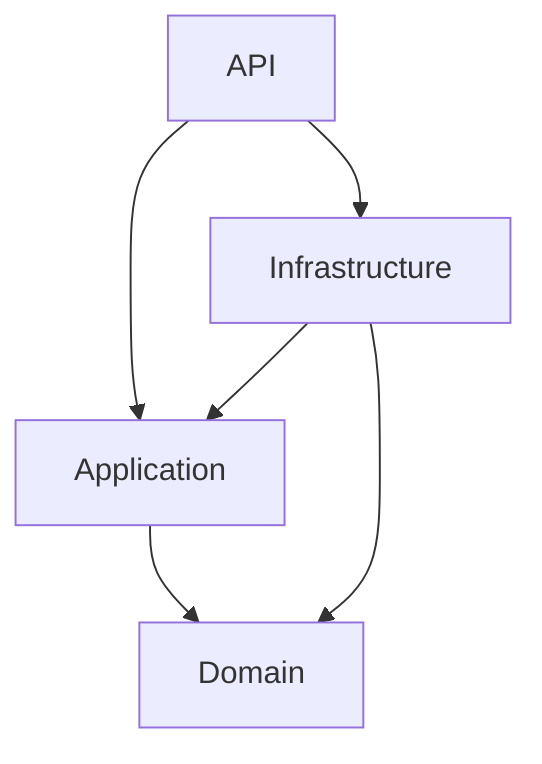
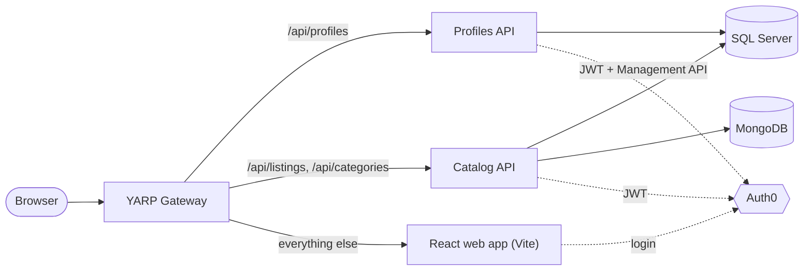

# Root Documentation Implementation Plan

> **For agentic workers:** REQUIRED SUB-SKILL: Use superpowers:subagent-driven-development (recommended) or superpowers:executing-plans to implement this plan task-by-task. Steps use checkbox (`- [ ]`) syntax for tracking.

**Goal:** Add `LICENSE.md`, `STRUCTURE.md` and `README.md` at the repository root so the public repo presents as a portfolio project.

**Architecture:** README is a lean showcase that links to STRUCTURE.md (all folder/layering detail) and LICENSE.md. No content is duplicated between README and STRUCTURE. The client's Feature-Sliced Design detail stays in `Clients/mc.market.reactwebapp/README.md` and is linked.

**Tech Stack:** Markdown, GitHub-flavoured Mermaid diagrams.

Spec: `docs/superpowers/specs/2026-11-09-root-docs-design.md`

## Global Constraints

- Files live at the repo root: `README.md`, `STRUCTURE.md`, `LICENSE.md`.
- License: MIT, copyright line exactly `Copyright (c) 2026 nick4real`.
- Only Profiles and Catalog are described as running. The other nine services are labelled "Scaffolded".
- Mermaid labels containing parentheses or slashes must be double-quoted.
- Relative links must resolve from the repo root (verification command below).
- Every fact in these files was verified against the code on 2026-11-09:
  - Gateway routes (`Gateway/MC.Gateway/appsettings.json`): `api/profiles/**` → profiles, `api/listings/**` and `api/categories/**` → catalog, everything else → React app.
  - AppHost parameters (`Aspire/MC.Aspire.AppHost/AppHost.cs`): `Auth0-Domain`, `Auth0-Audience`, `Auth0-BackendM2M-ClientId`, `Auth0-BackendM2M-ClientSecret`, `Auth0-Frontend-ClientId`.
  - SQL Server host port `14333`; containers `MC.SqlServer`, `MC.MongoDB`, `MC.MongoExpress` with persistent lifetime and data volumes.
  - Seeding (`Aspire/MC.Aspire.AppHost/appsettings.json`): `Seeding:Mode` defaults to `Reset`; modes are `None`, `IfEmpty`, `Reset`.
  - Catalog stores categories and locations in SQL Server and listings in MongoDB.
  - Integration tests set `MarketCustoms:TestService` (`catalog`, `profiles`, `ordering`, `notifications`), which makes the AppHost start only that service with session-scoped containers and a local test identity instead of Auth0.
  - `scripts/ef.js` usage: `npm run ef:<add|remove|list> -- <ServiceName> [MigrationName]`.

**Link verification command** (run from repo root; expected output: nothing):

```powershell
foreach ($f in 'README.md','STRUCTURE.md','LICENSE.md') { if (Test-Path $f) { Select-String -Path $f -Pattern '\]\((?!https?://|#)([^)#]+)' -AllMatches | ForEach-Object { $_.Matches } | ForEach-Object { $p = $_.Groups[1].Value; if (-not (Test-Path $p)) { "MISSING in ${f}: $p" } } } }
```

---

### Task 1: LICENSE.md

**Files:**
- Create: `LICENSE.md`

**Interfaces:**
- Produces: `LICENSE.md` at root, linked from README in Task 3.

- [ ] **Step 1: Create `LICENSE.md`** with exactly this content:

```markdown
# MIT License

Copyright (c) 2026 nick4real

Permission is hereby granted, free of charge, to any person obtaining a copy
of this software and associated documentation files (the "Software"), to deal
in the Software without restriction, including without limitation the rights
to use, copy, modify, merge, publish, distribute, sublicense, and/or sell
copies of the Software, and to permit persons to whom the Software is
furnished to do so, subject to the following conditions:

The above copyright notice and this permission notice shall be included in all
copies or substantial portions of the Software.

THE SOFTWARE IS PROVIDED "AS IS", WITHOUT WARRANTY OF ANY KIND, EXPRESS OR
IMPLIED, INCLUDING BUT NOT LIMITED TO THE WARRANTIES OF MERCHANTABILITY,
FITNESS FOR A PARTICULAR PURPOSE AND NONINFRINGEMENT. IN NO EVENT SHALL THE
AUTHORS OR COPYRIGHT HOLDERS BE LIABLE FOR ANY CLAIM, DAMAGES OR OTHER
LIABILITY, WHETHER IN AN ACTION OF CONTRACT, TORT OR OTHERWISE, ARISING FROM,
OUT OF OR IN CONNECTION WITH THE SOFTWARE OR THE USE OR OTHER DEALINGS IN THE
SOFTWARE.
```

- [ ] **Step 2: Verify**

Run: `Select-String -Path LICENSE.md -Pattern 'Copyright \(c\) 2026 nick4real'`
Expected: one match on line 3.

- [ ] **Step 3: Commit**

```bash
git add LICENSE.md
git commit -m "docs: add MIT license"
```

---

### Task 2: STRUCTURE.md

**Files:**
- Create: `STRUCTURE.md`

**Interfaces:**
- Consumes: nothing.
- Produces: `STRUCTURE.md` at root, linked from README in Task 3.

- [ ] **Step 1: Create `STRUCTURE.md`** with exactly this content:

````markdown
# Project structure

MarketCustoms is a single repository containing every backend service, the API gateway, the web client and the tests, orchestrated locally by .NET Aspire.

## Top level

```text
Aspire/
  MC.Aspire.AppHost/          Aspire orchestrator: containers, services, client, test composition
  MC.Aspire.ServiceDefaults/  Shared telemetry, health checks, service discovery, resilience
Clients/
  mc.market.reactwebapp/      React storefront (Vite + TypeScript)
Gateway/
  MC.Gateway/                 YARP reverse proxy, the single entry point for the client
Services/
  <Service>/                  One folder per bounded context, four projects each
  Shared/                     Cross-cutting building blocks used by every service
Tests/
  <Service>/                  Unit and integration test projects per service
scripts/
  ef.js                       EF Core migration helper behind the root npm scripts
.github/workflows/            GitHub Actions pipelines

MarketCustoms.slnx            Solution file (XML format)
Directory.Packages.props      Central NuGet package versions
aspire.config.json            Points the Aspire CLI at the AppHost
package.json                  Root npm scripts (EF migrations)
dotnet-tools.json             Local .NET tool manifest
```

## Service layering

Every service under `Services/<Service>/` follows the same Clean Architecture split into four projects, named `MC.<Service>.<Layer>`:

| Project | Responsibility |
| --- | --- |
| `MC.<Service>.API` | ASP.NET Core host: controllers, request/response contracts, validation wiring, `Program.cs` |
| `MC.<Service>.Application` | Use cases and application services, DTOs, repository and service interfaces |
| `MC.<Service>.Domain` | Entities, value objects and domain rules, with no infrastructure dependencies |
| `MC.<Service>.Infrastructure` | EF Core / MongoDB persistence, repositories, external integrations, seeding |



Domain depends on nothing. Application depends only on Domain. Infrastructure implements the interfaces declared in Application. API composes everything at startup.

## Services

| Service | Bounded context |
| --- | --- |
| Profiles | User profiles and account types, synchronised with Auth0 users |
| Catalog | Categories, locations and listings |
| Ordering | Orders placed by buyers |
| Shopping | Buyer-side shopping flow before an order is placed |
| Financial | Payments and payouts |
| Delivering | Shipping and delivery of orders |
| Promotion | Promoted listings and discounts |
| Interaction | Interactions between buyers and sellers |
| Notifications | User notifications |
| Statistics | Marketplace analytics |

Only Profiles and Catalog are wired into the AppHost today. The rest are scaffolded with the four-project layout.

Persistence per running service:

- **Profiles:** SQL Server (EF Core).
- **Catalog:** SQL Server for categories and locations, MongoDB for listings.

## Shared

`Services/Shared/` holds code reused by all services. It has no Domain project because it carries no business vocabulary.

| Project | Provides |
| --- | --- |
| `MC.Shared.API` | `AddAuthenticationDefaults()` (Auth0 JWT, or a local test identity when `Authentication:UseLocalTestIdentity` is set), a base `CustomController`, and `UseClientCancellationLogging()` middleware that logs client-aborted requests |
| `MC.Shared.Application` | `Result` / `Error` types, pagination models and parameters, `IUnitOfWork`, `ICurrentUserService` |
| `MC.Shared.Infrastructure` | Deterministic database seeding (`IDatabaseSeeder`, seeding options and modes) and `Auth0CurrentUserService` |

## Gateway

`Gateway/MC.Gateway` is a YARP reverse proxy and the only externally exposed endpoint. Routes are defined in `appsettings.json` and resolved to service addresses through Aspire service discovery:

| Path | Destination |
| --- | --- |
| `/api/profiles/*` | Profiles service |
| `/api/listings/*`, `/api/categories/*` | Catalog service |
| everything else | React web app |

## Aspire

- **AppHost** builds the local environment: SQL Server and MongoDB containers (plus Mongo Express), the Profiles and Catalog services, the Vite dev server and the gateway. It passes Auth0 and seeding settings to each resource. When `MarketCustoms:TestService` is set, it switches to an isolated composition that starts a single service for integration tests.
- **ServiceDefaults** is referenced by every host and adds OpenTelemetry, `/health` and `/alive` endpoints, service discovery and HTTP resilience.

## Clients

`Clients/mc.market.reactwebapp` is the React storefront, organised with Feature-Sliced Design. See its [README](Clients/mc.market.reactwebapp/README.md) for the layer rules and commands.

## Tests

```text
Tests/
  <Service>/
    MC.<Service>.UnitTests/         Fast tests for Domain and Application logic
    MC.<Service>.IntegrationTests/  Run the service through Aspire.Hosting.Testing with real containers
  Shared/
    MC.Shared.UnitTests/
```

Test projects exist for Catalog, Profiles, Ordering, Notifications and Shared. They use xUnit v3.

## Conventions

- All projects are prefixed `MC.` and namespaced to match their folder.
- NuGet versions are managed centrally in `Directory.Packages.props`. Project files reference packages without a version.
````

- [ ] **Step 2: Verify links and Mermaid quoting**

Run the link verification command from Global Constraints.
Expected: no output.

Run: `Select-String -Path STRUCTURE.md -Pattern '^\s+\w+\[(?![("])[^\]]*[()/]'`
Expected: no output (no unquoted Mermaid labels with parentheses or slashes).

- [ ] **Step 3: Commit**

```bash
git add STRUCTURE.md
git commit -m "docs: add project structure overview"
```

---

### Task 3: README.md

**Files:**
- Create: `README.md`

**Interfaces:**
- Consumes: `LICENSE.md` (Task 1), `STRUCTURE.md` (Task 2) — both linked.
- Produces: root `README.md`.

- [ ] **Step 1: Create `README.md`** with exactly this content:

````markdown
# MarketCustoms

A marketplace platform built as .NET Aspire–orchestrated microservices with a React storefront.

## Overview

MarketCustoms splits a buyer/seller marketplace into bounded-context services behind a YARP gateway. Each service follows Clean Architecture, owns its own data store, and authenticates requests with Auth0. Aspire brings up the whole system with one command: databases, services, gateway and web client.

## Tech stack

- **Backend:** .NET 10, ASP.NET Core, EF Core (SQL Server), MongoDB, FluentValidation, Mapster, Scalar (OpenAPI UI), Bogus (seed data)
- **Platform:** .NET Aspire 13, YARP reverse proxy, OpenTelemetry, service discovery, HTTP resilience
- **Auth:** Auth0 (JWT bearer on the APIs, Auth0 React SDK in the client)
- **Frontend:** React 19, TypeScript, Vite, TanStack Query, Zustand, React Router, Tailwind CSS 4, Feature-Sliced Design
- **Testing:** xUnit v3, Aspire.Hosting.Testing, Vitest

## Architecture



## Services

| Service | Bounded context | Status |
| --- | --- | --- |
| Profiles | User profiles and account types | Active |
| Catalog | Categories, locations and listings | Active |
| Ordering | Orders | Scaffolded |
| Shopping | Buyer shopping flow | Scaffolded |
| Financial | Payments and payouts | Scaffolded |
| Delivering | Shipping and delivery | Scaffolded |
| Promotion | Promoted listings and discounts | Scaffolded |
| Interaction | Buyer–seller interactions | Scaffolded |
| Notifications | User notifications | Scaffolded |
| Statistics | Marketplace analytics | Scaffolded |

Cross-cutting code (authentication defaults, result types, pagination, seeding) lives in `Services/Shared`.

## Getting started

### Prerequisites

- [.NET 10 SDK](https://dotnet.microsoft.com/download)
- Aspire CLI: `dotnet tool install --global Aspire.Cli`
- [Docker](https://www.docker.com/) (SQL Server, MongoDB and Mongo Express run as containers)
- [Node.js](https://nodejs.org/) for the web client
- An [Auth0](https://auth0.com/) tenant with an API, a single-page application and a machine-to-machine application

### Configure Auth0

Set the AppHost parameters as user secrets:

```bash
dotnet user-secrets --project Aspire/MC.Aspire.AppHost set "Parameters:Auth0-Domain" "<your-tenant>.auth0.com"
dotnet user-secrets --project Aspire/MC.Aspire.AppHost set "Parameters:Auth0-Audience" "<api-identifier>"
dotnet user-secrets --project Aspire/MC.Aspire.AppHost set "Parameters:Auth0-Frontend-ClientId" "<spa-client-id>"
dotnet user-secrets --project Aspire/MC.Aspire.AppHost set "Parameters:Auth0-BackendM2M-ClientId" "<m2m-client-id>"
dotnet user-secrets --project Aspire/MC.Aspire.AppHost set "Parameters:Auth0-BackendM2M-ClientSecret" "<m2m-client-secret>"
```

### Run

```bash
cd Clients/mc.market.reactwebapp && npm install && cd ../..
aspire run
```

The Aspire dashboard opens with every resource, its logs and its traces. Open the **marketCustomsGateway** endpoint to use the storefront. SQL Server is exposed on host port `14333`. Database containers persist between runs.

> **Seeding:** `Seeding:Mode` in `Aspire/MC.Aspire.AppHost/appsettings.json` defaults to `Reset`, which drops and reseeds the databases on every start. Set it to `IfEmpty` or `None` to keep your data.

## Testing

```bash
dotnet test
```

This runs unit and integration tests. Integration tests start the service under test through Aspire with throwaway containers and a local test identity, so they need Docker but not Auth0.

Web client tests:

```bash
cd Clients/mc.market.reactwebapp
npm run test
```

## Database migrations

EF Core migrations are wrapped by root npm scripts:

```bash
npm run ef:add -- Catalog AddCategoryTree
npm run ef:list -- Catalog
npm run ef:remove -- Catalog
```

## Project structure

See [STRUCTURE.md](STRUCTURE.md) for the repository layout, the service layering rules and what each project contains.

## License

Released under the [MIT License](LICENSE.md).
````

- [ ] **Step 2: Verify links and Mermaid quoting**

Run the link verification command from Global Constraints.
Expected: no output.

Run: `Select-String -Path README.md -Pattern '^\s+\w+\[(?![("])[^\]]*[()/]'`
Expected: no output.

- [ ] **Step 3: Verify fact consistency with STRUCTURE.md**

Run: `Select-String -Path README.md,STRUCTURE.md -Pattern 'Scaffolded|scaffolded'`
Expected: README has 8 "Scaffolded" rows; STRUCTURE mentions scaffolded once. Both list the same ten services.

- [ ] **Step 4: Preview rendering**

Push the branch or open the files in a Markdown preview with Mermaid support. Confirm both diagrams render and tables are aligned.

- [ ] **Step 5: Commit**

```bash
git add README.md
git commit -m "docs: add project README"
```
